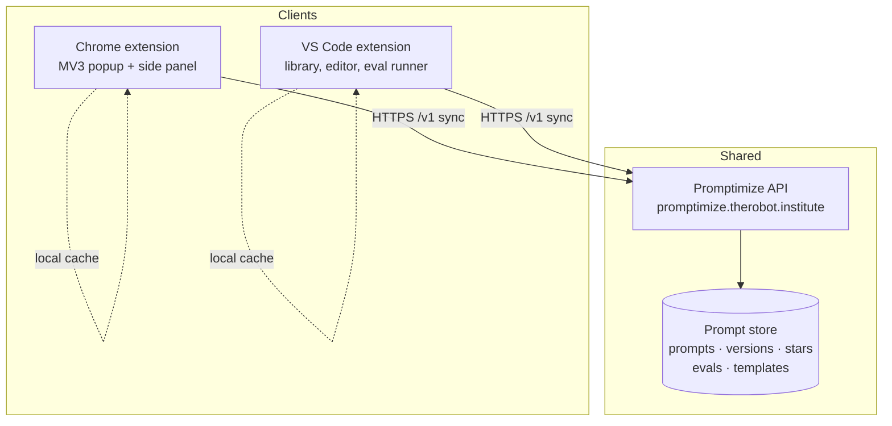

# Project Architecture

<!-- 〚📁:9c6fe096-8fdc-52d8-ac75-ed2dcf1dcfa3〛 PROJ-ARCH :: High-level architecture overview for promptimize. -->

## Overview

Promptimize is intended as a prompt library: capture, version, evaluate and
optimize prompts, reachable from two client surfaces (a Chrome Manifest V3
extension and a VS Code extension) over one shared, server-backed store. It is
**scaffold-stage**: the repository at this commit contains no client or backend
source — only the entry point README, a *draft* API contract
([docs/BACKEND.md](BACKEND.md)), and this documentation set. The architecture
below is therefore the *declared/intended* design from the draft contract and
README, not a description of running code. Treat it as a plan to be validated
when implementation lands.

The declared architectural style is **local-first clients over a central sync
API**: each client caches the library locally and syncs deltas when the backend
is reachable.

## System Diagram

## Core Components

| Component | Purpose | Present in repo? |
|-----------|---------|------------------|
| Chrome extension | MV3 popup + side-panel library, page capture ("paste to capture") | No — planned under `chrome/` |
| VS Code extension | Prompt library, editor, eval runner | No — planned under `vscode/` |
| Promptimize API | Shared prompt store: prompts, versions, stars, evals, templates, optimize/formulate | No — draft contract only |
| Local cache | Offline-first library copy in each client | No — described in README/BACKEND |

→ *Components ↔ directories: see [PROJ-LAYOUT.md](PROJ-LAYOUT.md).*

## Data Flow

A client reads and writes against its local cache; when the backend is reachable
it reconciles via `POST /v1/sync` (delta push/pull). Prompt edits produce
monotonic versions. Evals and optimizer outputs (`target: "npl" | "generic"`) are
stored beside the source prompt for side-by-side comparison. `POST /v1/formulate`
takes a template plus a short natural-language description and returns a hydrated
prompt draft.

→ *Endpoint and resource detail: [docs/BACKEND.md](BACKEND.md); shapes:
[PROJ-SCHEMA.md](PROJ-SCHEMA.md).*

## Technology Stack

| Layer | Declared |
|-------|----------|
| Clients | Chrome Manifest V3 extension; VS Code extension (TypeScript implied by toolchains; not yet in repo) |
| Transport | HTTPS REST, `/v1` JSON resources |
| Persistence | Not specified in-repo (draft contract only) |
| Hosting | `https://promptimize.therobot.institute` |
| License | MIT (the-robot-lives) |

## Key Decisions

- **Two clients, one store** — avoid divergent prompt libraries across the
  browser and the editor; both sync to the same API.
- **Local-first** — the library stays usable offline; sync is opportunistic.
- **Optimization is first-class** — optimizer outputs (including NPL form) are
  persisted alongside the original, enabling score/quality comparison over time.
- **NPL support** — explicit first-class support for Noizu Prompt Lingua
  conventions in the optimize path.

→ *See [arch/decisions.md](arch/decisions.md) if ADRs are added later.*
