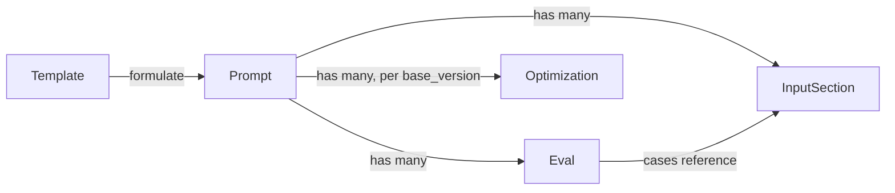

# Project Schema

<!-- 〚📁:118177e1-3fbb-53bd-a7a1-a32af613f5c2〛 PROJ-SCHEMA :: Data-model reference for promptimize (draft API shapes). -->

## Scope and Status

The repository contains **no persistence layer**: no SQL, no Ecto schemas, no
Liquibase changelogs, no migrations, no config-file schema, no KV/Redis usage.
The only structured data in the repo is the **data-interface schema** declared in
the draft API contract, [docs/BACKEND.md](BACKEND.md). Per the schema-doc scope
rule, this file documents that interface (request/response resource shapes)
instead of an ERD; ERD sections are intentionally omitted because no relational
schema exists.

> **Draft.** Resource shapes and auth are explicitly marked "working contract
> and will evolve" in BACKEND.md. Everything on this page must be re-derived from
> implementation once backend code lands.

## Data Kinds Present

| Data kind | Present? | Where |
|-----------|----------|-------|
| Relational persistence schema | No | — |
| Config-file schema | No | (`.gitignore` only; no config files) |
| Data files / fixtures | No | — |
| KV / Redis schema | No | — |
| Data-interface schema (API resources) | **Yes — draft** | `docs/BACKEND.md` |

## Resource Shapes (draft)

### Prompt

| Field | Type | Notes |
|-------|------|-------|
| `id` | uuid | Identifier |
| `title` | string | Display title |
| `body` | text | Current prompt text |
| `version` | int | Monotonic per prompt |
| `starred` | bool | Favorite / pinned |
| `tags` | string[] | Free-form tags |
| `input_sections` | `InputSection[]` | Typed form fields for hydration |
| `evals` | `Eval[]` | Attached eval cases/suites |
| `optimized` | `Optimization[]` | Optimizer outputs (incl. NPL form) kept beside the original |

### InputSection

`{ name, type, required, default?, help? }` — rendered as a fill-in form by
clients; hydration substitutes values into `{{name}}` placeholders.

### Eval

`{ id, prompt_id, cases: [{ input, expect }], scorer, last_run, score }` —
cases may reference input sections; runs are recorded per prompt version.

### Optimization

`{ id, prompt_id, base_version, target: "npl" | "generic", body, notes }` —
variants stored beside the source prompt for side-by-side comparison.

### Template (dynamic formulate)

`{ id, title, body_with_slots, description }` —
`formulate(template, user_description)` returns a hydrated, tailored prompt draft.

## Conceptual Relationships

These are *declared* relationships in the draft contract, not enforced by any
schema in-repo.

## Enumerations

| Enum | Values |
|------|--------|
| `Optimization.target` | `"npl"`, `"generic"` |

## Interface Endpoints (draft)

| Method(s) | Path | Purpose |
|-----------|------|---------|
| GET/POST | `/v1/prompts` | List / create prompts |
| GET/PUT/DELETE | `/v1/prompts/{id}` | Read / update / delete a prompt |
| POST | `/v1/prompts/{id}/star` | Toggle star |
| GET/POST | `/v1/prompts/{id}/versions` | Version history |
| GET/POST | `/v1/prompts/{id}/evals` | Evals; `POST …/evals/run` to run |
| GET/POST | `/v1/prompts/{id}/optimizations` | Optimizer outputs |
| GET/POST | `/v1/templates` | Prompt templates |
| POST | `/v1/formulate` | Hydrate a template from a description |
| POST | `/v1/sync` | Delta push/pull for local-first clients |

## Auth

Token-based per-client device token; OAuth-style device flow marked **TBD** in
the contract. No authentication scheme is implemented in-repo.

## Maintenance

When backend code lands, re-derive shapes from the implementation, add real
ERD sections (Mermaid + PlantUML) if a relational store appears, and replace the
draft tables above. Keep [PROJ-SCHEMA.summary.md](PROJ-SCHEMA.summary.md) in sync.
