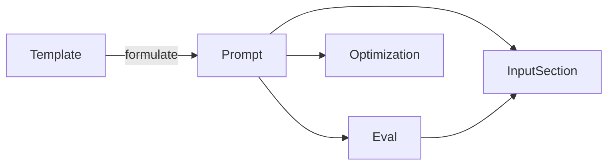

# Project Schema — Summary

Promptimize has **no persistence layer** in-repo (no SQL, Ecto, Liquibase, KV,
or config schema). The only structured data is the **draft API contract** in
`docs/BACKEND.md`. No ERDs — none applies; the shapes below are declared, not
enforced.

**Resources (draft):**

| Resource | Key fields |
|----------|-----------|
| `Prompt` | id, title, body, version, starred, tags, input_sections[], evals[], optimized[] |
| `InputSection` | name, type, required, default?, help? |
| `Eval` | id, prompt_id, cases[{input, expect}], scorer, last_run, score |
| `Optimization` | id, prompt_id, base_version, target("npl"\|"generic"), body, notes |
| `Template` | id, title, body_with_slots, description |

**Relationships:**

**Enum:** `Optimization.target` = `npl` | `generic`.

**Endpoints:** `/v1/prompts`, `/v1/prompts/{id}[/star|/versions|/evals|/optimizations]`,
`/v1/templates`, `/v1/formulate`, `/v1/sync`.

**Auth:** token / device flow — TBD in contract; nothing implemented.

→ Full detail: [PROJ-SCHEMA.md](PROJ-SCHEMA.md)
