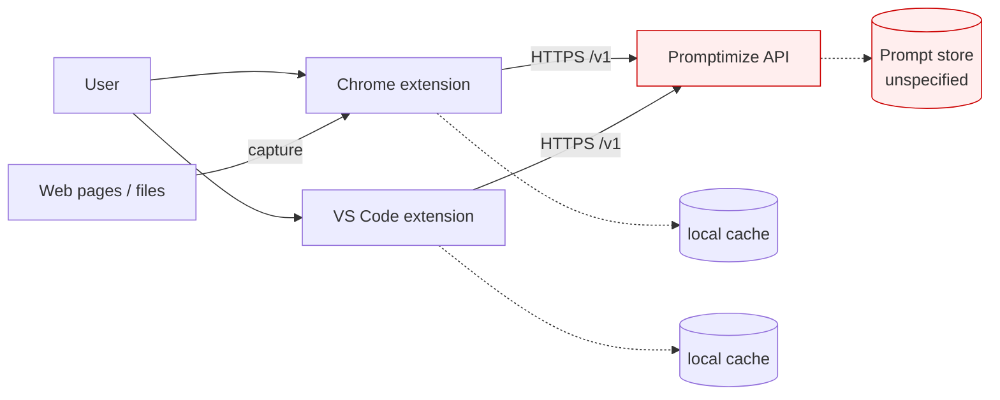

# Threat Model

<!-- 〚📁:b5f0c732-55a2-59f3-8229-52f4faa41f8f〛 THREAT-MODEL :: Living threat model for promptimize (scaffold stage). -->

## Overview

Promptimize is a **scaffold-stage** repository: no client or backend code is
present. This threat model therefore describes the *declared* attack surface from
`README.md` and the draft `docs/BACKEND.md`, and records that no mitigation is
implemented in-repo yet. It is deliberately honest: where the design says
"TBD", the corresponding control is recorded as **Open**, not assumed.

**Crown jewels (declared):** the user's prompt library — prompt bodies, edit
history, eval cases (which may embed proprietary inputs and expected outputs),
and optimizer outputs. Prompts are often the highest-value IP a team has, and
users routinely paste sensitive material into them; the store must be treated as
confidential data.

**Trust boundaries (declared):**

1. **Public internet ↔ Promptimize API** (`https://promptimize.therobot.institute`) —
   crosses over HTTPS; authentication is *undefined* in the draft contract
   (per-client device token / OAuth device flow, "TBD").
2. **Extension ↔ extension host** — Chrome MV3 extension and VS Code extension
   run in privileged contexts; content they capture from pages/files crosses into
   the store.
3. **Client ↔ local cache** — offline-first local copies of the library on disk.
4. **Backend ↔ persistence** — the store behind the API; persistence technology
   unspecified in-repo.

Because no code exists, boundaries 2–4 cannot be verified against source. Only
boundary 1 has any declared fact: the API base URL is HTTPS.

## Attack Surface

Red nodes: authentication and persistence are declared but undefined.

## Vulnerability Register

Severity reflects the *declared* design gap, not an observed exploit. All items
are **Open (not implemented in-repo)** — no code exists to mitigate them.

| ID | Severity | STRIDE | Component | Status |
|----|----------|--------|-----------|--------|
| T-001 | High | Spoofing / Elevation | API auth is "TBD"; no authentication scheme is defined for the shared multi-user store | Open |
| T-002 | High | Information disclosure | Prompt bodies, eval cases, and optimizer outputs are confidential IP; no at-rest encryption or access scoping is specified | Open |
| T-003 | Medium | Information disclosure | Local-first caches store the prompt library on client disk; encryption/OS-keychain protection unspecified | Open |
| T-004 | Medium | Tampering | `POST /v1/sync` is a delta push/pull with no specified conflict-authenticity or signature model | Open |
| T-005 | Medium | Elevation / Info disclosure | Browser-extension page capture pulls arbitrary page content into the store; no specified sanitization or origin allow-list | Open |
| T-006 | Low | Repudiation | No audit/version-provenance model beyond monotonic `version` ints; who-changed-what is not captured | Open |
| T-007 | Low | Denial of service | No rate limiting or quota declared for `/v1/*` | Open |

## Mitigation Coverage

0 mitigated · 0 partial · 7 open. This is expected for a scaffold-stage repo —
the register is a *to-implement* checklist, not evidence of a vulnerable
deployment. Only one perimeter fact is verifiable from source: the API base URL
is HTTPS (`https://promptimize.therobot.institute`), which addresses transport
confidentiality for boundary 1 but nothing else.

## Residual Risk

Accepted for now: this repository ships no runnable artifact, so none of the
register entries expose a live system. Residual risk materializes the moment the
API and clients are implemented, at which point T-001 and T-002 must be closed
before any non-team use.

→ *See [threats/attack-surface.md](threats/attack-surface.md) and
[threats/authn-authz.md](threats/authn-authz.md) when detail outgrows this page.*
